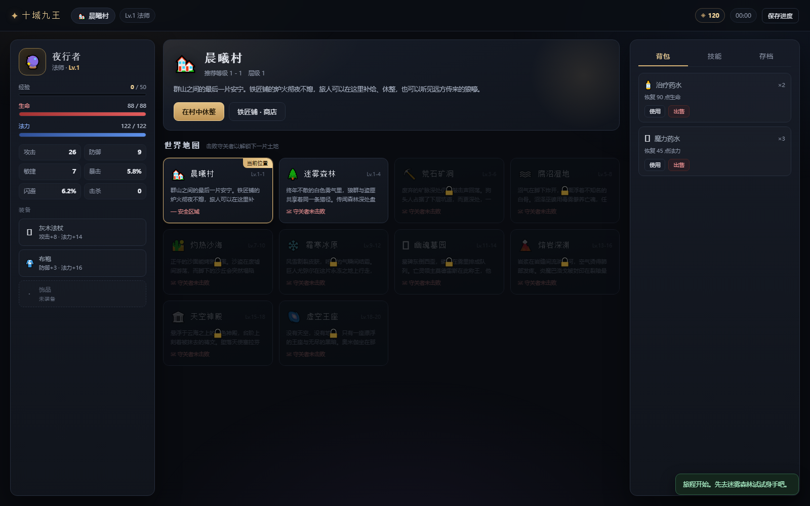
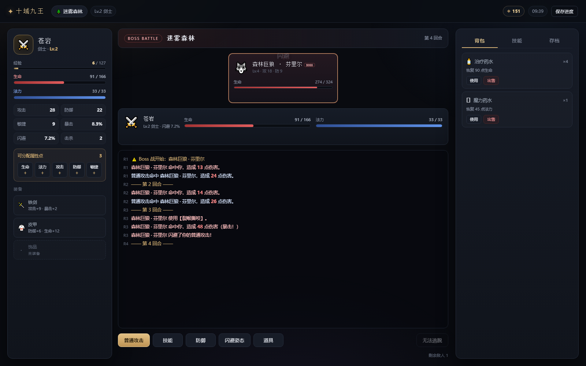
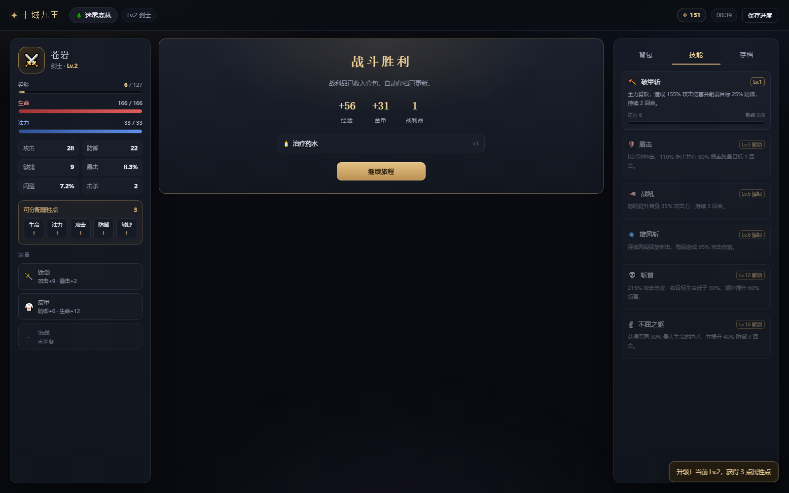

# 十域九王 · 回合制 RPG

一个可完整通关的**全栈回合制 RPG**：Python 标准库后端（REST API + 文件存档）+ 原生 JavaScript 单页前端。
四条职业路线、十片地图区域、九位守关 Boss，支持闪避判定、升级加点、随机掉落、技能熟练度成长，以及**战斗中途存档续玩**。


## 快速开始

环境要求：**Python 3.10+**（无需安装任何第三方库，不使用 Java）。

```bash
# Windows 双击 start.bat，或：
python run.py
```

启动后会自动打开 <http://127.0.0.1:8000>。可选参数：

```bash
python run.py --port 8080        # 指定端口（端口占用时自动顺延）
python run.py --no-browser       # 不自动打开浏览器
```

运行测试：

```bash
python tests/test_game.py        # 12 项测试：内容完整性、战斗、掉落、存档往返、中断续玩
```

## 功能对照

| 需求 | 实现 |
| --- | --- |
| 按角色/地图/战斗/敌人/装备/技能/存档拆分模块 | `backend/modules/` 下 7 个独立模块，`game.py` 只做编排 |
| 4 种职业 | 剑士、法师、游侠、牧师，独立基础属性、成长曲线、6 个专属技能与初始装备 |
| 10 个地图区域 | 晨曦村（安全区）+ 9 片战斗区域，逐区解锁 |
| 9 个 Boss | 每片战斗区域一位守关者，带专属技能、狂暴阶段、必掉稀有装备 |
| 回合制流程 | 按敏捷排序结算整回合，支持普攻/技能/防御/闪避姿态/道具/逃跑 |
| 闪避 | 敏捷决定基础闪避率，「闪避姿态」+35 个百分点，敌人攻击逐次判定 |
| 升级 | 经验曲线 `50 × Lv^1.35`，每级 +3 属性点，可分配生命/法力/攻击/防御/敏捷 |
| 掉落 | 5 档稀有度加权掉落，按区域层级与职业过滤装备池，Boss 保底稀有 |
| 技能成长 | 每施展一次 +1 熟练度，最高 5 级，每级 +15% 技能倍率 |
| 文件存档 | JSON 存档（自动 + 3 个手动槽位），原子写入，含战斗中状态 |
| 中断后继续 | 每回合自动存档；读档可回到战斗中的具体回合、血量、Buff 与敌人状态 |

## 界面

| 世界地图 | 战斗 |
| --- | --- |
|  |  |



## 目录结构

```
game-all zhai/
├─ run.py                    启动入口（端口探测 / 自动开浏览器）
├─ start.bat                 Windows 一键启动
├─ backend/
│  ├─ server.py              HTTP 服务：REST 路由 + 静态前端托管
│  ├─ game.py                服务层：编排各模块，维护当前存档会话
│  ├─ data_loader.py         JSON 内容加载与缓存
│  ├─ data/                  纯数据：职业、技能、装备、敌人、地图
│  │  ├─ classes.json        4 职业的基础属性 / 成长 / 初始装备
│  │  ├─ skills.json         24 个技能（4 职业 × 6）
│  │  ├─ equipment.json      稀有度、装备模板、消耗品
│  │  ├─ enemies.json        27 种小怪 + 9 个 Boss
│  │  └─ areas.json          10 个区域与解锁链
│  ├─ modules/
│  │  ├─ character.py        属性计算、经验升级、加点、伤害公式
│  │  ├─ map.py              解锁、移动、探索随机事件
│  │  ├─ battle.py           回合状态机、闪避/暴击/状态效果、奖励结算
│  │  ├─ enemy.py            敌人实例、Buff/DOT/眩晕、序列化
│  │  ├─ equipment.py        掉落生成、穿戴、背包、商店
│  │  ├─ skill.py            技能解锁、熟练度、倍率
│  │  └─ save.py             JSON 存档、原子写入、槽位管理
│  └─ storage/saves/         存档目录（运行时生成）
├─ frontend/
│  ├─ index.html             单页骨架：开始界面 / 三栏游戏界面
│  ├─ css/style.css          暗色奇幻主题、响应式、动画
│  └─ js/                    api.js（请求）/ ui.js（渲染）/ main.js（交互）
├─ tests/test_game.py        逻辑与存档测试
└─ docs/screenshots/         界面截图
```

## 核心设计

### 1. 回合结算

一次 `POST /api/battle` 结算**一整个回合**：

1. 玩家行动入队，每个敌人按技能权重选择意图；
2. 玩家与所有敌人按 `敏捷 + 随机抖动` 降序行动；
3. 行动时依次判定：眩晕跳过 → 命中/闪避 → 暴击 → 护盾吸收 → 扣血 → 附加状态；
4. 回合结束：结算中毒/灼烧、再生、Buff 过期，回合数 +1。

这样前端只需一次请求就能拿到完整战报，且战斗状态天然可序列化。

### 2. 伤害与闪避

```
减伤 = 100 / (100 + 有效防御 × 1.55)
伤害 = 攻击 × 技能倍率 × 减伤 × 暴击(1.75) × 随机(±8%)
```

- 物理技能穿透 0%，法术默认穿透 50% 护甲，「湮灭」100% 无视护甲；
- 玩家闪避 = `3% + 敏捷×0.45%`（上限 30%），装备与「闪避姿态」可叠加，硬上限 75%；
- 敌人也有基于敏捷的闪避，多段技能逐段独立判定命中与暴击。

### 3. 状态效果

统一用「到期回合」记录：`expires = 当前回合 + 持续回合`，避免 Buff 在施加当回合就失效。
支持攻击/防御/敏捷增减、闪避提升、护盾、再生、中毒、灼烧、眩晕、净化、斩杀增伤、对负面状态增伤、吸血。

### 4. 技能成长

技能不靠金币升级，而是**用出来**：每次施展 +1 熟练度，升级所需次数 `8 × 当前等级`，满级 5 级。
每级提升 15% 倍率，前端展示熟练度进度条。

### 5. 掉落

- 稀有度权重：普通 52 / 精良 27 / 稀有 13 / 史诗 6 / 传说 2；
- 装备池按「区域层级 ≤ 地图层级」且「职业匹配」过滤，避免法师掉巨剑；
- 属性随掉落等级与稀有度缩放，Boss 保底稀有并按 Boss 等级生成。

### 6. 存档

`backend/storage/saves/<slot>.json`，结构：

```json
{
  "version": 1,
  "saved_at": "2026-10-19T17:11:41",
  "meta": { "name": "苍岩", "level": 2, "area_name": "迷雾森林", "playtime": 579 },
  "character": { "level": 2, "exp": 6, "hp": 91, "gold": 151,
                 "equipment": { "weapon": {...} }, "inventory": [...],
                 "skills": { "war_cleave": { "level": 1, "exp": 3 } } },
  "world": { "area": "forest", "unlocked": ["village", "forest"], "bosses": [] },
  "battle": { "round": 4, "enemies": [...], "player_buffs": [...] }
}
```

- 写入用「临时文件 + `os.replace`」，断电不会留下半截存档；
- 每次行动、每回合战斗后自动写入 `auto` 槽；手动槽位 1–3 可随时覆盖/读取/删除；
- `battle` 非空时读档会直接恢复战斗，包括回合数、敌人血量、Buff 与战斗日志。

## API 一览

| 方法 | 路径 | 说明 |
| --- | --- | --- |
| GET | `/api/meta` | 职业、区域、内容数量 |
| GET | `/api/state` | 当前完整状态（角色/地图/战斗/技能/存档列表） |
| POST | `/api/new` | `{name, class_id}` 新建游戏 |
| POST | `/api/load` | `{slot}` 读档 |
| POST | `/api/action` | 世界操作：`explore/travel/rest/challenge_boss/equip/unequip/sell/use_item/buy/allocate/save/delete_save` |
| POST | `/api/battle` | `{action: attack/skill/defend/dodge/item/flee, skill_id?, item_id?, target?}` |
| POST | `/api/save` | `{slot}` 手动存档 |
| POST | `/api/delete-save` | `{slot}` 删除存档 |

错误统一返回 `{"error": "...", "state": {...}}`，前端可直接回滚到服务端状态。

## 内容规模

| 类别 | 数量 | 说明 |
| --- | --- | --- |
| 职业 | 4 | 剑士 / 法师 / 游侠 / 牧师 |
| 技能 | 24 | 每职业 6 个，Lv.1/3/5/8/12/16 解锁 |
| 区域 | 10 | 晨曦村 + 迷雾森林 → 虚空王座 |
| 小怪 | 27 | 每区域 3 种，随区域层级增强 |
| Boss | 9 | 芬里尔 / 戈尔登 / 摩伽娜 / 阿兹拉 / 尤弥尔 / 莫德雷斯 / 巴洛戈 / 塞拉芬 / 奥米伽 |
| 装备模板 | 24 | 武器 12（分职业）、护甲 6、饰品 6 |
| 消耗品 | 5 | 治疗、高级治疗、魔力、解毒、秘银灵药 |

## 参考与借鉴

动手前调研了 GitHub 上的同类开源项目，主要借鉴了它们的结构思路，代码全部重写：

- [Aspect022/Terminal-RPG-Adventure](https://github.com/Aspect022/Terminal-RPG-Adventure) — 职业/背包/存档/动态难度的文本 RPG 组织方式；
- [Miguel-Marquess/python-rpg-battle-system](https://github.com/Miguel-Marquess/python-rpg-battle-system) — 职业、武器、暴击与状态效果的 OOP 战斗拆分；
- [marblexu/PythonStrategyRPG](https://github.com/marblexu/PythonStrategyRPG) — 回合制行动顺序与地图节点的分层设计；
- [Levrk/PYTHON-RPG](https://github.com/Levrk/PYTHON-RPG) — 多层地牢 + 装备 + 升级的循环；
- [1MDAFNANULLABAIG/Fantasy-RPG-Python](https://github.com/1MDAFNANULLABAIG/Fantasy-RPG-Python) — JSON 存档 + Boss 战 + 成就式进程。

差异点：这些项目多为命令行单机程序，本项目做成了**前后端分离的 Web 应用**，并把战斗状态完整纳入存档，支持真正的「关掉浏览器再回来继续打」。

## 可扩展方向

- 数据全部在 `backend/data/*.json`，新增职业/区域/Boss 不需要改代码；
- `save.py` 预留了 `version` 字段，可做旧存档迁移；
- 若要联机，可把 `GameService` 的单会话换成按玩家 ID 的多会话，并在 `battle.py` 中引入行动队列。
