# 十域九王 · 回合制 RPG

一个可完整通关的**全栈回合制 RPG**：Python 标准库后端（REST API + 文件存档）+ 原生 JavaScript 单页前端。
四条职业路线、十片地图区域、九位守关 Boss、十章主线剧情，支持闪避判定、升级加点、随机掉落、技能熟练度成长、
**战斗中途存档续玩**，以及**零素材的实时合成音乐与音效**。

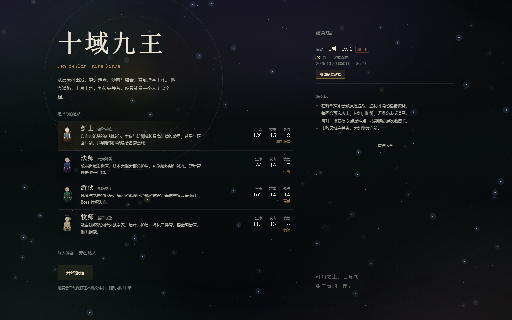

## 快速开始

环境要求：**Python 3.10+**（无需安装任何第三方库，不使用 Java）。

```bash
# Windows 双击 start.bat，或：
python run.py
```

启动后会自动打开 <http://127.0.0.1:8000>。可选参数：

```bash
python run.py --port 8080        # 指定端口（端口占用时自动顺延）
python run.py --no-browser       # 不自动打开浏览器
```

运行测试：

```bash
python tests/test_game.py        # 18 项测试：内容完整性、战斗、掉落、叙事、存档往返、中断续玩
```

## 功能对照

| 需求 | 实现 |
| --- | --- |
| 按角色/地图/战斗/敌人/装备/技能/存档拆分模块 | `backend/modules/` 下 7 个独立模块，`game.py` 只做编排 |
| 4 种职业 | 剑士、法师、游侠、牧师，独立基础属性、成长曲线、6 个专属技能与初始装备 |
| 10 个地图区域 | 晨曦村（安全区）+ 9 片战斗区域，逐区解锁 |
| 9 个 Boss | 每片战斗区域一位守关者，带专属技能、狂暴阶段、必掉稀有装备 |
| 回合制流程 | 按敏捷排序结算整回合，支持普攻/技能/防御/闪避姿态/道具/逃跑 |
| 闪避 | 敏捷决定基础闪避率，「闪避姿态」+35 个百分点，敌人攻击逐次判定 |
| 升级 | 经验曲线 `50 × Lv^1.35`，每级 +3 属性点，可分配生命/法力/攻击/防御/敏捷 |
| 掉落 | 5 档稀有度加权掉落，按区域层级与职业过滤装备池，Boss 保底稀有 |
| 技能成长 | 每施展一次 +1 熟练度，最高 5 级，每级 +15% 技能倍率 |
| 文件存档 | JSON 存档（自动 + 3 个手动槽位），原子写入，含战斗中状态 |
| 中断后继续 | 每回合自动存档；读档可回到战斗中的具体回合、血量、Buff 与敌人状态 |
| 章节剧情 | 序章 + 10 章目标 + 9 段 Boss 前对话 + 9 段遗言 + 结局页，全部数据驱动 |
| 声音 | Web Audio 实时合成的 7 首 BGM 与 14 种音效，零音频文件 |

## 界面

| 开始 | 行旅图 |
| --- | --- |
|  | 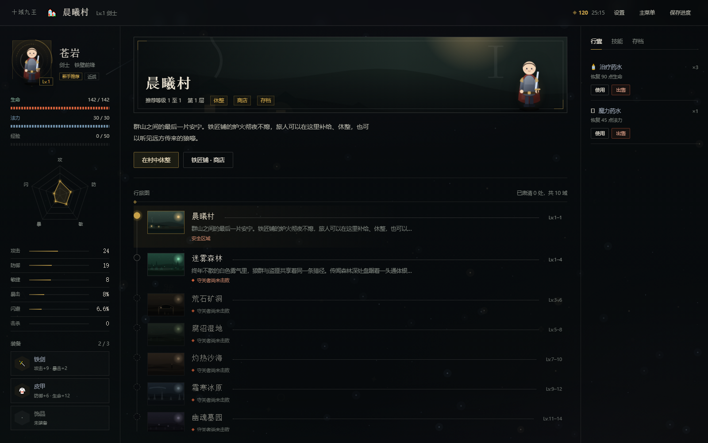 |

| 战斗 | 结算 |
| --- | --- |
| 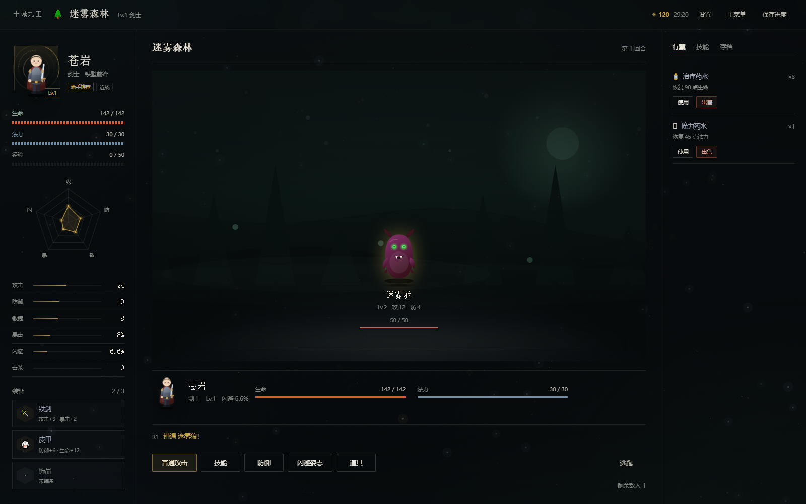 | 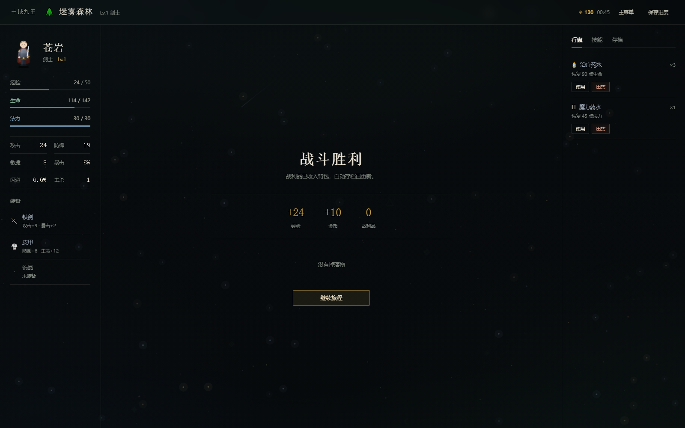 |

| 设置 | 主题切换 |
| --- | --- |
| 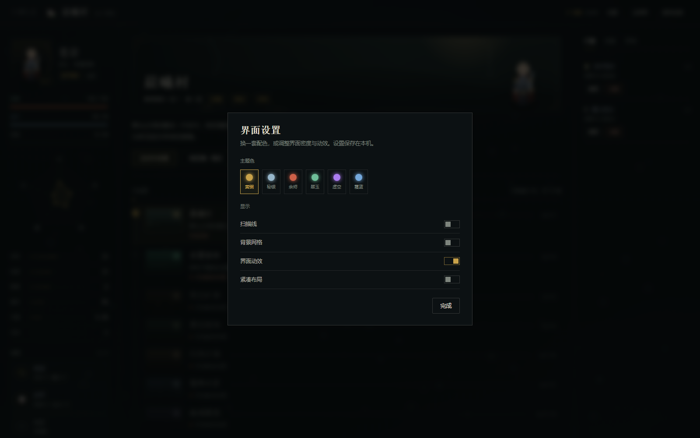 | 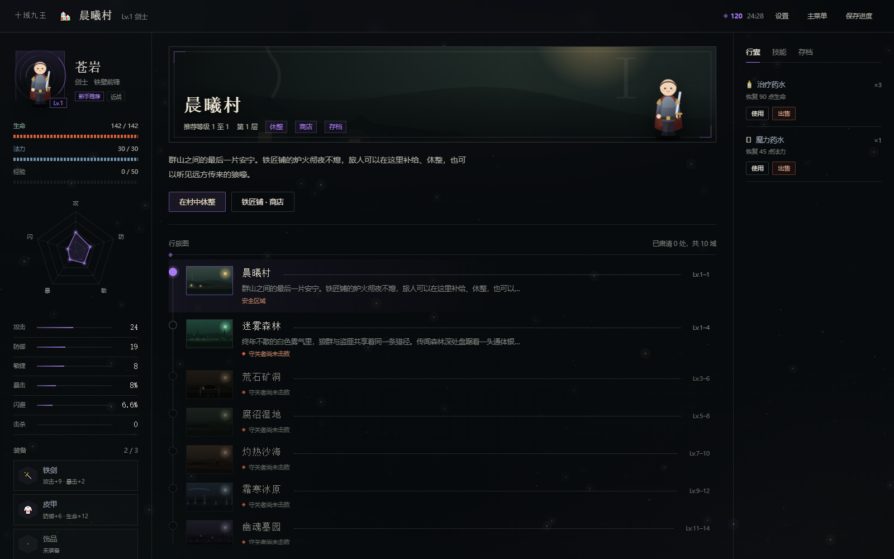 |

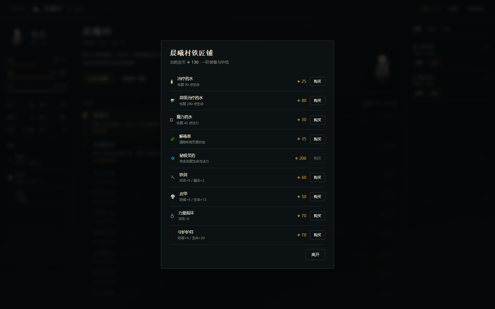


## 界面设计

设计方向是**行旅图**。十片区域本身有顺序，所以世界不用卡片网格，而是一条纵向路线；战斗不用三个盒子，而是地平线舞台；界面不做「每个模块一个圆角卡片」的套件，而是一整块面板加 1px 分隔线。

- **色板**：墨青黑 `#080B0D`、骨白 `#E9E3D6`、苔绿 `#7FA893`（生命）、余烬 `#D2603A`（危险）、黄铜 `#C8A24A`（奖励）、冷蓝 `#6F8FA8`（法力）。金色只出现在奖励与当前进度上。
- **字体**：标题用宋体、大字号、收紧字距；正文苹方 14px、行高 1.7。不使用全大写标签，也不用中点拼接元信息。
- **结构**：开始界面是左标题右存档的编辑式双栏；游戏界面是 `236 / 自适应 / 288` 三栏，靠分隔线而不是卡片阴影分区。
- **地图**：一条连续的线串起十片土地，节点区分已肃清、当前、未解锁，右上角用罗马数字标出这是第几域。
- **插画**：十片区域各有一张程序化生成的 SVG 风景（村落灯火、森林松影、矿洞坑口、沼泽枯木、沙海方尖碑、冰原极光、墓园碑影、熔岩火山、神殿列柱、虚空裂隙），既做区域横幅，也做路线缩略图；当前区域的横幅里站着你的角色。
- **角色栏**：六边形头像框外套三层反向旋转的法阵环，生命/法力/经验是分段式读数条，中间是五维雷达图（攻/防/敏/暴/闪），下面是带微条属性的数值表与六边形装备插槽。
- **战斗**：战场背景铺的是当前区域的风景，敌人站在地平线上，没有卡片边框；玩家条在下方，战斗日志折叠成三行。
- **设置**：可切换六套主题色（黄铜、秘银、余烬、翠玉、虚空、霜蓝），开关扫描线、背景网格、界面动效与紧凑布局，全部存在 `localStorage`。

## 视觉与演出

前端没有引入任何图片素材、动画库或构建工具，所有画面都由 **CSS + 内联 SVG + Canvas** 生成。

### 1. 电影化开场

首屏是一段约 6 秒的序章：星空推进 → 双环法阵描边旋转 → 「十域九王」逐字浮现 → 英文副标题打字机 → 字幕与暗角收束，最后淡入标题界面。

- 支持 **点击 / 空格 / Esc 跳过**，右上角也有「跳过序章」；
- 看过一次后写入 `localStorage`，之后直接进标题界面；开始界面底部「重播序章」可随时回看；
- 新角色开局时额外播放一张**章节卡**（序章 + 区域名 + 角色名与职业），把开场和玩家身份连起来。


### 2. 会动的小人

`fx.js` 内置一个参数化的 SVG 角色生成器：

- **4 个职业各一套**：剑士（阔剑 + 铁甲）、法师（尖帽 + 法杖宝珠）、游侠（兜帽 + 长弓）、牧师（光环 + 法杖），配色、发型、武器均不同；
- 每个小人由 `root / breathe / cloak / head / weapon` 分层，常驻**呼吸起伏、披风摆动、头部微晃、武器轻摆、脚下光环**五组循环动画；
- 战斗时叠加状态动画：`attacking` 前冲 + 挥砍，`hurt` 受击红闪 + 抖动，`casting` 施法光晕，倒下后灰化缩小；命中瞬间在敌人身上生成斩击圆环；
- **怪物同样是程序化 SVG**：按敌人 ID 哈希出色相、犄角样式、眼睛数量（2/3 只），Boss 额外带王冠与红色光晕；
- **区域风景也是程序化 SVG**：`Sprite.scene(areaId)` 按区域拼出天空渐变、双层山脊、月亮光晕、星点、地平线雾气与该区域专属地物；
- 小人出现在所有关键位置：职业列表、角色栏、区域横幅、战斗双方。

### 3. 魔幻背景

分五层叠加，全部随区域换色：

| 层 | 实现 |
| --- | --- |
| 星海 | Canvas 绘制三层视差星点 + 闪烁 + 流星，随鼠标轻微位移 |
| 星云 | 两团大面积模糊径向渐变，40–48 秒缓慢漂移呼吸 |
| 极光 | 三条 `mix-blend-mode: screen` 的斜向光带，23–37 秒摆动 |
| 雾霭 | 底部径向雾团，28 秒呼吸 |
| 符文 | 14 个随机漂浮的几何符文，16–34 秒上升循环 |

外加暗角与 3.5% 颗粒噪点做质感。**每个区域有独立色相**（森林翠绿、矿洞琥珀、熔岩赤红、冰原冰蓝、虚空紫红……），切换地图时整屏色调平滑过渡。

### 4. 层级与动效

- 界面不用卡片堆叠，改用**分隔线 + 字重 + 字号**建立层级，鼠标悬停只在路线和职业行上做轻微位移；
- 战斗区是一条地平线加地面光晕，敌人站在线上，靠投影与雾气区分远近；
- 升级时从角色位置爆出 22 颗粒子，是全局唯一一处自发运动。

### 5. 切场动画

调研了 GitHub 上的 `swup/swup`、`barba/barba.js` 以及 `anime.js` / GSAP 这类方案：前两者面向多页站点（依赖真实 URL 跳转与 History API），本项目是单页应用，套不上；后两者为了几百毫秒的过渡引入一个动画引擎，性价比不高。最终选择浏览器原生的 **View Transitions API**——零依赖、走合成层、不阻塞主线程，只在 `document.startViewTransition()` 里包一层渲染即可。

按场景设计了 6 种过渡（`FX.scene(kind, render)`）：

| 场景 | 效果 |
| --- | --- |
| `dive` 标题 → 游戏 | 旧画面放大 + 模糊散开，新世界从 0.9 倍清晰落定，像镜头钻进画面 |
| `encounter` 地图 → 战斗 | 旧画面被推开压暗，新战斗画面用 `clip-path: circle()` 从中心圆形展开，亮度 2.4 倍回落，落地后接 0.42s 屏幕震动 |
| `travel` 区域移动 | 横向视差推移 + 模糊，方向感明确 |
| `victory` 战斗胜利 | 金色过曝闪白 + 结果卡放大落定，同时炸出粒子 |
| `defeat` 战败 | 去饱和 + 压暗收束 |
| `soft` 通用 | 轻微缩放淡入，用于读档、返回菜单、结算后继续 |

浏览器不支持 View Transitions 时自动退回「暗场遮罩 + 内容入场」的降级方案，功能不受影响。序章退场也改成了穿越式：整体放大、提亮、模糊，并叠加一层白光扩散。

> 系统开启「减少动态效果」时，所有切场直接同步渲染；星海、极光、雾霭与符文也会自动关闭。


## 声音：仓库里没有一个音频文件

音乐与音效都在浏览器里用振荡器实时合成，没有 mp3/ogg/wav，也不加载任何音频素材。

| 层 | 方案 | 职责 |
| --- | --- | --- |
| 音效 | [ZzFX](https://github.com/KilledByAPixel/ZzFX)（MIT，1.2KB） | 按「起音/持续/释放/波形/滑音/噪声」参数一次性生成 PCM |
| 音乐 | [TinyMusic](https://github.com/kevincennis/TinyMusic)（MIT，3KB） | 小型音序器，用 `'A3 h'` 这样的字符串写谱，一个 `Sequence` 一条声部 |
| 编排 | 自研 `audio.js` | 音乐/音效总线、切曲淡入淡出、静音与音量持久化、首次手势解锁 |

**7 首 BGM**，每首 2–3 个声部（低音 / 铺底 / 旋律），按场景而不是按区域切换，避免十首曲子互相打断：

| 曲目 | 场景 | 速度与性格 |
| --- | --- | --- |
| `title` | 标题界面 | 72 BPM，A 小调，稀疏、悬置 |
| `village` | 晨曦村 | 84 BPM，C 大调，温暖的三音循环 |
| `wild` | 森林 / 矿洞 / 沙海 | 104 BPM，D 小调，行进感 |
| `dark` | 沼泽 / 冰原 / 墓园 / 熔岩 / 神殿 / 虚空 | 88 BPM，持续低音 + 半音游移 |
| `battle` | 普通遭遇战 | 132 BPM，八分音符推进 |
| `boss` | 守关者 | 146 BPM，半音下行，压迫感 |
| `ending` | 结局页 | 68 BPM，回到 C 大调 |

**14 种音效**：点击、翻页、命中、暴击、法术、治疗、闪避、格挡、咆哮、战败、拾取、错误、存档、回合提示，外加胜利 / 升级 / 结局三组琶音。

几个实现细节：

- 切曲不是换文件，而是新曲目增益从 0 拉到 1、旧曲目 0.5 秒淡出后停止振荡器，所以换场景不会硬切；
- 战斗音乐优先级高于区域音乐，`mood()` 检测到当前是 `battle`/`boss` 时不会覆盖；
- 浏览器自动播放策略要求手势，`AudioContext` 在首次 `pointerdown`/`keydown` 时恢复，在此之前请求的曲目会被记住并在解锁后补播；
- 设置里可分别开关音乐与音效、拖动音量，写入 `localStorage`；按 **M** 一键静音。

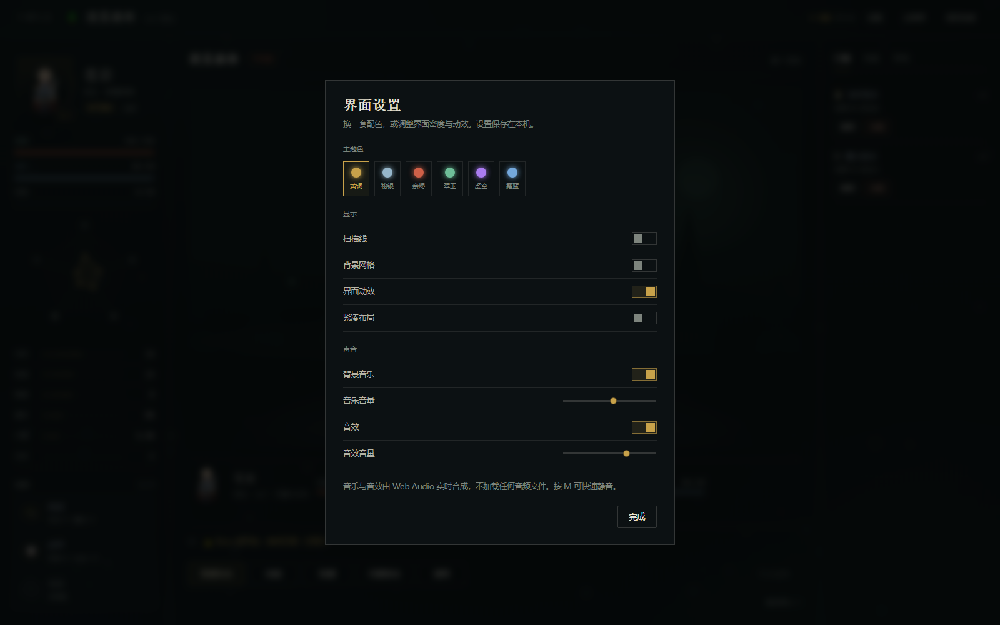

## 叙事：十把椅子

`backend/data/story.json` 里是 **10 章、68 条台词、约 1300 字**正文：序章 → 每章一段进区旁白 → Boss 前对话 → Boss 遗言 → 结局。

- **章节推进不存状态**。`story.py` 从「已击败的守关者」反推当前章节，找第一个没打过的 Boss。所以读档、重开、改档都不会出现「剧情和进度对不上」。
- **三处触发**：新游戏播序章；首次踏入某区域播该区旁白（`visited` 决定只播一次）；挑战守关者前播对话。
- **Boss 对话是确认闸门，不是服务端状态**。`challenge_boss` 第一次只返回 `dialogue` 不开战，前端播完带 `confirmed: true` 再请求一次。这样刷新页面永远不会卡在对话中间。
- **结局**在击败奥米伽后解锁，带 6 项统计（等级 / 击败 / 守关者 / 金币 / 行程 / 用时）；看过一次写 `ending_seen`，不会每次刷新都弹。
- **地图页顶部常驻「当前目标」**，显示章节、目标文本与守关者进度条，玩家永远知道下一步去哪。

| 章节旁白 | Boss 前对话 |
| --- | --- |
| 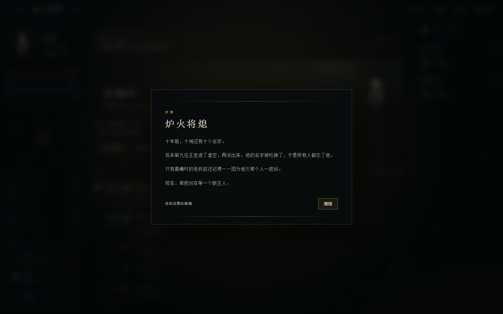 | 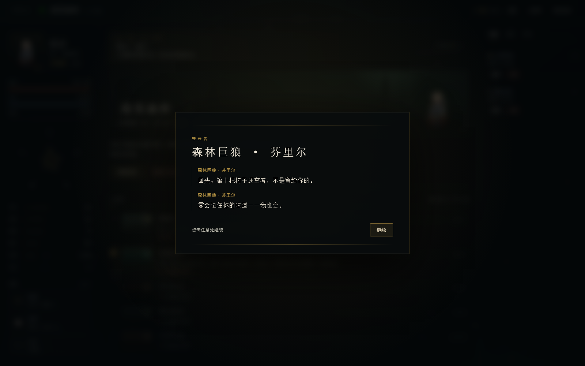 |

| 当前目标 | 结局 |
| --- | --- |
| 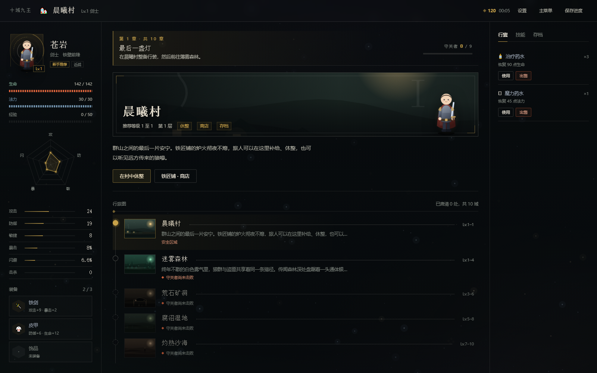 | 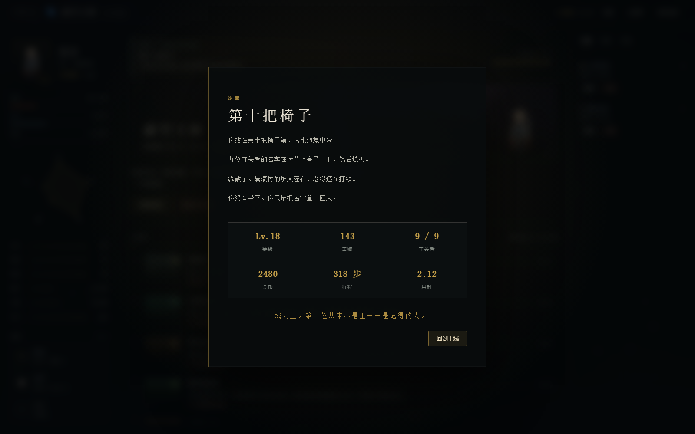 |

## 目录结构

```
game-all zhai/
├─ run.py                    启动入口（端口探测 / 自动开浏览器）
├─ start.bat                 Windows 一键启动
├─ backend/
│  ├─ server.py              HTTP 服务：REST 路由 + 静态前端托管
│  ├─ game.py                服务层：编排各模块，维护当前存档会话
│  ├─ data_loader.py         JSON 内容加载与缓存
│  ├─ data/                  纯数据：职业、技能、装备、敌人、地图、剧情
│  │  ├─ classes.json        4 职业的基础属性 / 成长 / 初始装备
│  │  ├─ skills.json         24 个技能（4 职业 × 6）
│  │  ├─ equipment.json      稀有度、装备模板、消耗品
│  │  ├─ enemies.json        27 种小怪 + 9 个 Boss
│  │  ├─ areas.json          10 个区域与解锁链
│  │  └─ story.json          序章、10 章旁白与 Boss 对话、结局
│  ├─ modules/
│  │  ├─ character.py        属性计算、经验升级、加点、伤害公式
│  │  ├─ map.py              解锁、移动、探索随机事件
│  │  ├─ battle.py           回合状态机、闪避/暴击/状态效果、奖励结算
│  │  ├─ enemy.py            敌人实例、Buff/DOT/眩晕、序列化
│  │  ├─ equipment.py        掉落生成、穿戴、背包、商店
│  │  ├─ skill.py            技能解锁、熟练度、倍率
│  │  ├─ story.py            章节目标、进区旁白、Boss 对话、结局
│  │  └─ save.py             JSON 存档、原子写入、槽位管理
│  └─ storage/saves/         存档目录（运行时生成）
├─ frontend/
│  ├─ index.html             单页骨架：开场序章 / 开始界面 / 三栏游戏界面
│  ├─ css/
│  │  ├─ style.css           设计系统：色板、字阶、布局、组件
│  │  └─ fx.css              特效层：星海背景、小人动画、序章、转场、叙事浮层
│  └─ js/
│     ├─ api.js              fetch 封装
│     ├─ audio.js            音频编排：总线、切曲、静音、音量
│     ├─ narrative.js        叙事浮层：章节卡、逐条台词、结局页
│     ├─ fx.js               星海 + 程序化小人 + 转场演出
│     ├─ ui.js               纯渲染层（状态 → DOM 字符串）
│     ├─ main.js             交互、事件委托、战斗流程
│     └─ vendor/             ZzFX 与 TinyMusic（MIT，附许可证）
├─ tests/test_game.py        逻辑与存档测试
└─ docs/screenshots/         界面截图
```

## 核心设计

### 1. 回合结算

一次 `POST /api/battle` 结算**一整个回合**：

1. 玩家行动入队，每个敌人按技能权重选择意图；
2. 玩家与所有敌人按 `敏捷 + 随机抖动` 降序行动；
3. 行动时依次判定：眩晕跳过 → 命中/闪避 → 暴击 → 护盾吸收 → 扣血 → 附加状态；
4. 回合结束：结算中毒/灼烧、再生、Buff 过期，回合数 +1。

这样前端只需一次请求就能拿到完整战报，且战斗状态天然可序列化。

### 2. 伤害与闪避

```
减伤 = 100 / (100 + 有效防御 × 1.55)
伤害 = 攻击 × 技能倍率 × 减伤 × 暴击(1.75) × 随机(±8%)
```

- 护甲穿透按技能类型给默认值：物理 12%（熟练度每级 +3%，满级 24%）、法术 50%，「湮灭」100% 无视护甲；
  数据里写 `pierce` 字段可直接覆盖默认值；
- 玩家闪避 = `3% + 敏捷×0.45%`（上限 30%），装备与「闪避姿态」可叠加，硬上限 75%；
- 敌人也有基于敏捷的闪避，多段技能逐段独立判定命中与暴击。

### 3. 状态效果

统一用「到期回合」记录：`expires = 当前回合 + 持续回合`，避免 Buff 在施加当回合就失效。
支持攻击/防御/敏捷增减、闪避提升、护盾、再生、中毒、灼烧、眩晕、净化、斩杀增伤、对负面状态增伤、吸血。

### 4. 技能成长

技能不靠金币升级，而是**用出来**：每次施展 +1 熟练度，升级所需次数 `8 × 当前等级`，满级 5 级。
每级提升 15% 倍率，前端展示熟练度进度条。

### 5. 掉落

- 稀有度权重：普通 52 / 精良 27 / 稀有 13 / 史诗 6 / 传说 2；
- 装备池按「区域层级 ≤ 地图层级」且「职业匹配」过滤，避免法师掉巨剑；
- 属性随掉落等级与稀有度缩放，Boss 保底稀有并按 Boss 等级生成；
- 商店报价与卖出回购用**同一个价格锚点**（都由 `make_item` 按当前等级生成），
  买入价永远高于卖出价，杜绝「低买高卖」刷金币。

### 5.1 平衡是如何定的

数值不是凭手感调的。`tools/balance_sim.py` 用**真实的 `Battle` / `Character` 代码**
跑蒙特卡洛，两把标尺：

| 标尺 | 等级 | 装备 | 加点 | 药品 |
| --- | --- | --- | --- | --- |
| 标准玩家 | 区域推荐等级下限 | 精良 | 均分 | 4 瓶小药 |
| 熟练玩家 | 区域推荐等级上限 | 稀有 | 主加攻击 | 3 瓶大药 |

```bash
python tools/balance_sim.py --runs 150          # 打印全职业 × 全 Boss 胜率表
python tools/balance_sim.py --check             # 断言胜率落在 30%~95%
```

设计目标是：**每个职业达到 50% 胜率所需等级，都落在该区域的推荐等级区间内**。
这条线一旦偏移，就说明某个环节的成长曲线断了，而不是「玩家菜」。
`tests/test_game.py` 里有对应的回归测试，改数值导致线塌掉会直接失败。

### 6. 存档

`backend/storage/saves/<slot>.json`，结构：

```json
{
  "version": 1,
  "saved_at": "2026-10-19T17:11:41",
  "meta": { "name": "苍岩", "level": 2, "area_name": "迷雾森林", "playtime": 579 },
  "character": { "level": 2, "exp": 6, "hp": 91, "gold": 151,
                 "equipment": { "weapon": {...} }, "inventory": [...],
                 "skills": { "war_cleave": { "level": 1, "exp": 3 } } },
  "world": { "area": "forest", "unlocked": ["village", "forest"], "bosses": [] },
  "battle": { "round": 4, "enemies": [...], "player_buffs": [...] }
}
```

- 写入用「临时文件 + `os.replace`」，断电不会留下半截存档；
- 每次行动、每回合战斗后自动写入 `auto` 槽；手动槽位 1–3 可随时覆盖/读取/删除；
- `battle` 非空时读档会直接恢复战斗，包括回合数、敌人血量、Buff 与战斗日志。

## API 一览

| 方法 | 路径 | 说明 |
| --- | --- | --- |
| GET | `/api/meta` | 职业、区域、内容数量 |
| GET | `/api/state` | 当前完整状态（角色/地图/战斗/技能/存档列表） |
| POST | `/api/new` | `{name, class_id}` 新建游戏 |
| POST | `/api/load` | `{slot}` 读档 |
| POST | `/api/action` | 世界操作：`explore/travel/rest/challenge_boss/equip/unequip/sell/use_item/buy/allocate/story_seen/save/delete_save` |
| POST | `/api/battle` | `{action: attack/skill/defend/dodge/item/flee, skill_id?, item_id?, target?}` |
| POST | `/api/save` | `{slot}` 手动存档 |
| POST | `/api/delete-save` | `{slot}` 删除存档 |

错误统一返回 `{"error": "...", "state": {...}}`，前端可直接回滚到服务端状态。

## 内容规模

| 类别 | 数量 | 说明 |
| --- | --- | --- |
| 职业 | 4 | 剑士 / 法师 / 游侠 / 牧师 |
| 技能 | 24 | 每职业 6 个，Lv.1/3/5/8/12/16 解锁 |
| 区域 | 10 | 晨曦村 + 迷雾森林 → 虚空王座 |
| 小怪 | 27 | 每区域 3 种，随区域层级增强 |
| Boss | 9 | 芬里尔 / 戈尔登 / 摩伽娜 / 阿兹拉 / 尤弥尔 / 莫德雷斯 / 巴洛戈 / 塞拉芬 / 奥米伽 |
| 装备模板 | 24 | 武器 12（分职业）、护甲 6、饰品 6 |
| 消耗品 | 5 | 治疗、高级治疗、魔力、解毒、秘银灵药 |
| 剧情章节 | 10 | 序章 + 十章目标，68 条台词，约 1300 字 |
| BGM | 7 | 标题 / 村落 / 荒野 / 暗域 / 战斗 / 守关者 / 结局 |
| 音效 | 14 + 3 组琶音 | 命中、暴击、法术、治疗、闪避、咆哮、胜负、升级…… |

## 参考与借鉴

动手前调研了 GitHub 上的同类开源项目，主要借鉴了它们的结构思路，代码全部重写：

- [Aspect022/Terminal-RPG-Adventure](https://github.com/Aspect022/Terminal-RPG-Adventure) — 职业/背包/存档/动态难度的文本 RPG 组织方式；
- [Miguel-Marquess/python-rpg-battle-system](https://github.com/Miguel-Marquess/python-rpg-battle-system) — 职业、武器、暴击与状态效果的 OOP 战斗拆分；
- [marblexu/PythonStrategyRPG](https://github.com/marblexu/PythonStrategyRPG) — 回合制行动顺序与地图节点的分层设计；
- [Levrk/PYTHON-RPG](https://github.com/Levrk/PYTHON-RPG) — 多层地牢 + 装备 + 升级的循环；
- [1MDAFNANULLABAIG/Fantasy-RPG-Python](https://github.com/1MDAFNANULLABAIG/Fantasy-RPG-Python) — JSON 存档 + Boss 战 + 成就式进程。

声音部分没有自己造轮子，直接复用了两个成熟的小库（均为 MIT，许可证随代码放在 `frontend/js/vendor/`）：

- [KilledByAPixel/ZzFX](https://github.com/KilledByAPixel/ZzFX) — 用一组参数合成音效，1.2KB，js13k 圈子的事实标准；
- [kevincennis/TinyMusic](https://github.com/kevincennis/TinyMusic) — 用音符字符串写谱的极简音序器，3KB。

叙事部分调研过 [y-lohse/inkjs](https://github.com/y-lohse/inkjs) 与 [YarnSpinnerTool/YarnSpinner](https://github.com/YarnSpinnerTool/YarnSpinner)，
两者都需要「剧本 → 编译 → 运行时」的构建链，而本项目的对话是线性旁白，用一份 JSON 加 120 行 Python 更划算，所以没有引入。

差异点：这些项目多为命令行单机程序，本项目做成了**前后端分离的 Web 应用**，并把战斗状态完整纳入存档，支持真正的「关掉浏览器再回来继续打」。

## 可扩展方向

- 数据全部在 `backend/data/*.json`，新增职业/区域/Boss 不需要改代码；
- 剧情同样在 `story.json`，加一章就是加一条数据：`area / kicker / title / goal / enter / boss_pre / boss_post`；
- `save.py` 预留了 `version` 字段，可做旧存档迁移；
- 若要联机，可把 `GameService` 的单会话换成按玩家 ID 的多会话，并在 `battle.py` 中引入行动队列。
